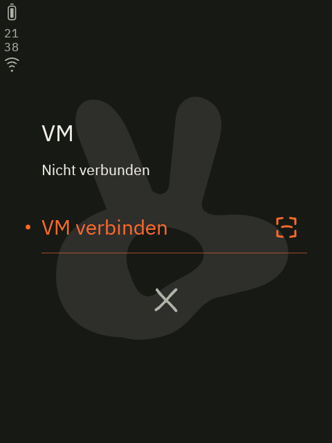

<p align="center">
  
</p>

<h1 align="center">Unrabbit</h1>

<p align="center">A minimal Android frontend for the rabbit r1.<br>Designed to work with your own Ubuntu VM.</p>

<p align="center"><a href="SETUP.md">Setup</a> · <a href="ROADMAP.md">Roadmap</a> · <a href="docs/ARCHITECTURE.md">Architecture</a> · <a href="https://github.com/philkoerber/unrabbit/actions/workflows/android.yml">Build</a></p>

<p align="center">
  
  
</p>

**Early prototype.** The native Android app connects to an Ubuntu VM through QR-based SSH pairing; the full scan-to-reply flow has been checked in an emulator. Docker is also available for local development. Speech and the default agent's replies are simulated; requests, photo transfers, persistence and recovery are real. A tested r1 installation is still ahead. The screenshots show the actual app, currently in German.

## The idea

One continuous chat, a physical wheel and a morphing mark. Speak with the side button, read the response, keep going. The VM will manage context and tools. The device stays small.

The prototype already has:

- Wheel/button navigation, dark mode and live battery, clock and Wi-Fi status.
- A continuously morphing logo and quiet transitions.
- Local photo drafts that accompany the next spoken request.
- Scan-to-connect setup: pinned SSH, a device-owned key and no on-device connection fields.
- Persistent local history and a reversible emulator kiosk mode.
- A local Ubuntu worker with durable jobs, photo transfer, cancellation and result recovery after app restart.
- A three-step Linux terminal wizard with agent/address detection, saved VM settings and a terminal QR.
- An optional Codex CLI adapter, verified with real text and camera-image replies over remote SSH.

## Try it

With JDK 21 and Android SDK 35 installed:

```sh
cd android
./gradlew :core:test :app:testDebugUnitTest :app:assembleDebug :app:lintDebug
```

Start with the [emulator setup](SETUP.md). Use **↑/↓ for the wheel** and **← for the side button**. Double-press ← to open the photo camera.

To develop both sides locally, with Docker running and the debug app installed:

```sh
python3 scripts/local_vm.py up
python3 scripts/local_vm.py attach
```

See the [local VM guide](vm/README.md) for tests, shutdown and the optional Codex adapter. The default setup makes no model/API calls.

For real Codex responses, an [optional Ubuntu image](vm/README.md#real-codex-locally) installs the CLI and uses a separate personal login in a private Docker volume. Live text responses have been verified locally; model requests still go to OpenAI.

Connect your own VM with the [terminal wizard](SETUP.md#terminal-wizard), then scan its QR in the app.

On your Linux VM, use `scripts/unrabbit.py setup` with the [setup dependencies](SETUP.md#terminal-wizard). Codex and an offline demo are selectable; other detected CLIs are marked as not yet supported. The short-lived QR enrolls the device and checks the real SSH connection. No private key is transferred.

SSH enrollment, host verification and chat requests have automated integration coverage. A native camera scan, device-key creation and replies over remote SSH have also been checked in the emulator. The Unrabbit SSH port must be reachable; the wizard leaves existing system and firewall configuration untouched. See [verified status](docs/STATUS.md) for the device/network checks.

The [status notes](docs/STATUS.md) separate working features from planned integrations. The [design notes](docs/DESIGN.md) describe the interface.

## Contribute

Small, focused contributions are welcome. See [CONTRIBUTING.md](CONTRIBUTING.md) and the [roadmap](ROADMAP.md).

[MIT](LICENSE) for original project code. Fonts and dependencies retain their [own licenses](THIRD_PARTY_NOTICES.md).

An independent project, not affiliated with Rabbit Inc.
