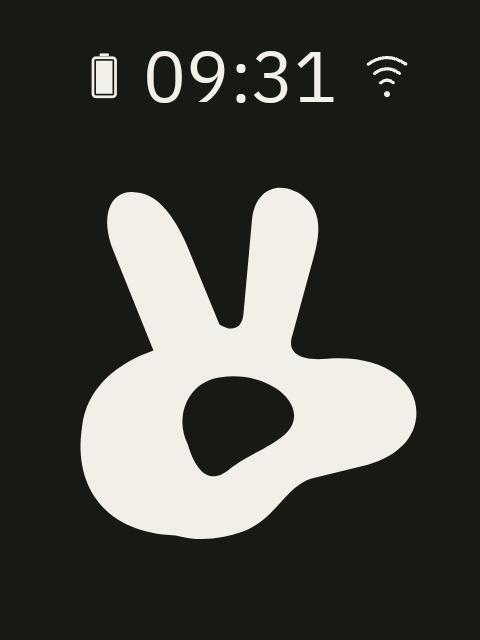

<p align="center">
  
</p>

<h1 align="center">Unrabbit</h1>

<p align="center">A minimal Android frontend for the rabbit r1.<br>Designed to work with your own Ubuntu VM.</p>

<p align="center"><a href="SETUP.md">Setup</a> · <a href="ROADMAP.md">Roadmap</a> · <a href="docs/ARCHITECTURE.md">Architecture</a> · <a href="https://github.com/philkoerber/unrabbit/actions/workflows/android.yml">Build</a></p>

<p align="center">
  
  
</p>

**Early prototype.** The native Android app runs in an emulator. Speech and replies are simulated; SSH, the VM service and a tested r1 installation are still ahead. The screenshots show the actual app, currently in German.

## The idea

One continuous chat, a physical wheel and a morphing mark. Speak with the side button, read the response, keep going. The VM will manage context and tools. The device stays small.

The prototype already has:

- Wheel/button navigation, dark mode and live battery, clock and Wi-Fi status.
- A continuously morphing logo and quiet transitions.
- Local photo drafts that accompany the next spoken request.
- QR-based connection setup and a port wheel, with no on-device typing.
- Persistent local history and a reversible emulator kiosk mode.

## Try it

With JDK 21 and Android SDK 35 installed:

```sh
cd android
./gradlew :core:test :app:testDebugUnitTest :app:assembleDebug :app:lintDebug
```

Start with the [emulator setup](SETUP.md). Use **↑/↓ for the wheel** and **← for the side button**. Double-press ← to open the photo camera.

The [status notes](docs/STATUS.md) separate working features from planned integrations. The [design notes](docs/DESIGN.md) describe the interface.

## Contribute

Small, focused contributions are welcome. See [CONTRIBUTING.md](CONTRIBUTING.md) and the [roadmap](ROADMAP.md).

[MIT](LICENSE) for original project code. Fonts and dependencies retain their [own licenses](THIRD_PARTY_NOTICES.md).

An independent project, not affiliated with Rabbit Inc.
