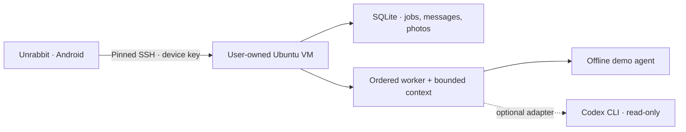

# Architecture

The device handles interaction; one user-owned Ubuntu VM handles the work. The QR wizard connects the device directly to that VM; an Ubuntu container remains available for local development.

`DemoTransport` remains available in debug builds without setup. The debug-only `VmHttpTransport` connects to the real local worker. Speech input is still simulated.

## Device

Kotlin and native Android Views/Canvas, with no WebView. `core/` contains chat state, stable request IDs, input gestures and connection validation. `app/` owns rendering, camera lifecycles and private local storage.

A photo remains an unsent draft until the next valid submission. Up to four photos accompany that request without duplicating their messages. The app stores its outbox before sending. Requests retain their IDs after reconnect/restart, so completed results can be collected without repeating work or duplicating replies. Recovery requires the same backend identity.

The local HTTP transport accepts only loopback URLs installed by the emulator helper. It stops polling when paused, backs off on transient failures, and makes no status calls when no work is outstanding. Release builds include the SSH transport and internet permission, but no debug HTTP adapter.

One visible chat does not mean deleted history. The app retains full local history; the service retains submitted requests and results. A bounded device cache and multi-device synchronization remain future work. Previous standalone demo messages are not automatically uploaded.

## Ubuntu service

Python, AsyncSSH, SQLite and a single worker, running under an unprivileged user. Requests and photo bytes are committed together. Original data survives context-window reduction. Cancellation wins over late results. After a server crash, running jobs are marked interrupted rather than silently replayed; untouched queued jobs resume.

The server selects context from recent completed turns and controls the agent/workspace. The optional Codex adapter receives current photos and that context via a fresh, read-only CLI invocation. Its execution contract is fixture-tested, and a live text response/recovery round trip has been verified with the emulator. Semantic summarization, model-driven tool/image workflows and tool/project routing remain unverified or unimplemented.

The opt-in `compose.codex.yaml` installs Codex in Ubuntu, with a separate login and workspace in named Docker volumes. No host home directory, host authentication or Docker socket is mounted. The default Compose configuration remains an offline demo. See the [local Codex setup](../vm/README.md#real-codex-locally) for the container's sandbox configuration and switching modes.

## QR pairing

The device connects directly to its owner’s VM, with no always-on Mac or Rabbit account. The wizard generates a short-lived, single-use invitation for Unrabbit’s own SSH endpoint. The app creates its key locally, checks the pinned host key, registers its public key, then verifies a key-authenticated service response before saving the connection. There are no editable connection fields on the device.

The endpoint implements only `unrabbit-pair` and `unrabbit-api`. It does not provide a shell or port forwarding and does not modify the system’s SSH configuration or authorized keys. Configuration, host identity and registered public keys are private files owned by the unprivileged service account. The selected TCP port must be reachable through any host/cloud firewall.

The current wizard keeps the service running in the foreground. Autostart and hardware installation/recovery are still separate tasks. See the [VM guide](../vm/README.md), [protocol](PROTOCOL.md) and [verified status](STATUS.md).
