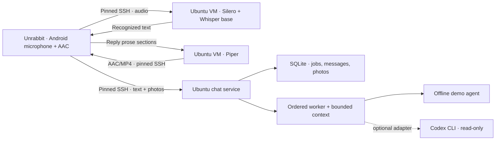

# Architecture

The device handles interaction; one user-owned Ubuntu VM handles the work. The QR wizard connects the device directly to that VM; an Ubuntu container remains available for local development.

The current product milestone is the r1-to-Codex request/reply loop. Future email, Notion and research integrations will use MCP servers configured on the VM, with their credentials kept there. They are outside the current implementation scope. The device records audio; the VM transcribes it and runs the agent. The VM also synthesizes reply audio, which the device plays.

`DemoTransport` remains available in debug builds for UI development, but speech requires a configured VM. The debug-only `VmHttpTransport` connects to the local Ubuntu worker and uses its authenticated speech endpoint.

## Speech

Foreground push-to-talk captures up to 30 seconds of 16 kHz mono PCM in device memory. Android's platform encoder produces AAC-LC at 32 kbit/s. A separate, ephemeral request sends this audio over the existing pinned SSH protocol. The VM uses CPU INT8 faster-whisper `base` and a Silero speech-presence check, retaining the complete utterance when speech is present. It returns text without creating an agent job. Only then does the app submit recognized text and waiting photos through the durable chat transport. Audio is not saved on the device or VM and is not sent to a hosted speech provider.

Welcome and settings offer an explicit spoken language, English by default or German. This also selects the reply voice. This skips automatic language detection; it does not shrink the model. The r1 benchmark held vocabulary hints constant: explicit language reduced `base` recognition from roughly eleven–twelve seconds to six seconds on the two microphone clips, before silence detection. Automatic language switching is outside the initial scope.

`speech-setup` downloads a revision-pinned model into the service account's data directory. The service loads it once at startup, without runtime model downloads, and accepts one recognition at a time. Missing setup returns 503; concurrent recognition returns 429. The API validates format, language, compressed size and AAC frame count before decoding, bounding audio to 30 seconds plus encoder padding. It accepts no file paths or remote URLs. The Android app contains no native recognition library or speech weights.

Each recording has its own cancellation identity. Leaving the foreground or cancelling stops capture, closes the speech connection and drops late callbacks. Already-started inference may finish on the VM, but it cannot start Codex or submit a chat request. Audio uploads are not queued or automatically retried; a failed upload requires a new recording. This differs from durable text/photo jobs, which recover after reconnect. Network availability, upload time and shared VM load now affect speech latency.

Reply audio uses Piper 1.8.0 on the VM, with Amy medium (`en_US`) and Ramona low (`de_DE`). `tts-setup` downloads revision- and SHA-256-pinned weights/configs/model cards. Both voices load at service startup; synthesis accepts one section at a time, independently of recognition and chat. No speech provider or API key is involved.

Text is displayed first. The app strips fenced code, raw URLs and common Markdown syntax, then reads prose in sections (first at most 160 characters, later sections at most 240; first 16,000 source characters). The VM bounds each generated clip to 30 seconds / 256 KiB, encodes AAC at 48 kbit/s in MP4 and returns it through the existing authenticated SSH protocol. The device prepares one next section while the current section plays; at most two compressed clips are retained in memory. Reply audio and extra synthesis text are not persisted or logged.

Playback is enabled by default with a persistent settings toggle and uses Android audio focus. A new press stops playback before the recording threshold. Pause, focus loss, leaving chat, disabling playback or switching VM cancels fetching/playback and rejects stale callbacks. An already-started VM section may finish after disconnection. No audio is queued for reconnect, and restored/recovered chat replies are not spoken automatically. Audio failure leaves the text usable. Hosted voices, private VM-side API-key entry and additional providers remain planned.

## Device

Kotlin and native Android Views/Canvas, with no WebView. `core/` contains chat state, stable request IDs, input gestures and connection validation. `app/` owns rendering, camera lifecycles and private local storage.

A photo remains an unsent draft until the next valid submission. Up to four photos accompany that request without duplicating their messages. The app stores its outbox before sending. Requests retain their IDs after reconnect/restart, so completed results can be collected without repeating work or duplicating replies. Recovery requires the same backend identity.

The local HTTP transport accepts only loopback URLs installed by the emulator helper. It stops polling when paused, backs off on transient failures, and makes no status calls when no work is outstanding. Release builds include the SSH transport and internet permission, but no debug HTTP adapter.

The app retains local text history; the service retains submitted requests and results. Photo files expire after seven days, with placeholders left in the chat. Schema 5 persists capture timestamps; legacy images inherit their original file modification time. An offline, persisted Android JobScheduler task cleans old image files hourly (subject to Android scheduling), and cleanup also runs on resume. Expired photos cannot be displayed or newly uploaded, and old unsent drafts do not join new requests. Multi-device synchronization and broader text-history/cache bounds remain future work. Previous standalone demo messages are not automatically uploaded.

## Ubuntu service

Python, AsyncSSH, SQLite and a single worker, running under an unprivileged user. Requests and photo bytes are committed together. Text survives context-window reduction; photo bytes expire seven days after capture (legacy records use original receipt time). Cleanup runs on startup, in the worker loop including idle time, and before context selection. SQLite secure deletion and a WAL checkpoint clear expired BLOBs while preserving metadata/digests for history and idempotence. Cancellation wins over late results. After a server crash, running jobs are marked interrupted rather than silently replayed; untouched queued jobs resume unless their required photos have expired.

The server selects at most 20 recent completed turns within a 24,000-character text budget and controls the agent/workspace. The optional Codex adapter receives current photos plus the newest available photos from those turns, within a four-image total, via a fresh read-only CLI invocation. Numbered attachments are mapped to their original turns so follow-up questions can inspect the same image. Job temporary copies are removed after each invocation; expiry during a call stops it. Its execution contract and image-follow-up path are fixture-tested. Semantic summarization and tool/project routing remain unverified or unimplemented.

The opt-in `compose.codex.yaml` installs Codex in Ubuntu, with a separate login and workspace in named Docker volumes. No host home directory, host authentication or Docker socket is mounted. The default Compose configuration remains an offline demo. See the [local Codex setup](../vm/README.md#real-codex-locally) for the container's sandbox configuration and switching modes.

## QR pairing

The device connects directly to its owner’s VM, with no always-on Mac or Rabbit account. The wizard generates a short-lived, single-use invitation for Unrabbit’s own SSH endpoint. The app creates its key locally, checks the pinned host key, registers its public key, then verifies a key-authenticated service response before saving the connection. There are no editable connection fields on the device.

The endpoint implements only `unrabbit-pair` and `unrabbit-api`. It does not provide a shell or port forwarding and does not modify the system’s SSH configuration or authorized keys. Configuration, host identity and registered public keys are private files owned by the unprivileged service account. The selected TCP port must be reachable through any host/cloud firewall.

The current wizard keeps the service running in the foreground. Autostart and hardware installation/recovery are still separate tasks. See the [VM guide](../vm/README.md), [protocol](PROTOCOL.md) and [verified status](STATUS.md).
