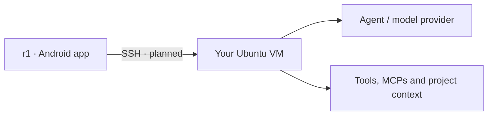

# Architecture

The device handles interaction. A single user-owned Ubuntu VM will handle the work.

The app currently uses a local `DemoTransport`. It has no network transport or real speech input. The VM side of this diagram is planned.

## Device

Kotlin and native Android Views/Canvas, with no WebView. `core/` contains chat state, stable request IDs, input gestures and connection validation. `app/` owns rendering, camera lifecycles and private local storage.

A photo is an unsent draft until the next valid text submission. That request carries all waiting photos; the existing photo messages are linked to it without being duplicated. Demo work is not replayed automatically after a restart.

One visible chat does not mean deleted history. The current prototype stores its complete demo history. A bounded device cache and server synchronization are future work.

## VM, planned

The VM will retain original messages, durable jobs and results. It will build working context, compact older context and route requests to the right projects and tools. The frontend will not require a second always-on computer or a Rabbit account.

The connection design uses an unprivileged server user, a device-owned key, a pinned host key and a restricted SSH entry point. Administrative private keys do not move to the device. Resume, cancellation and duplicate-request handling must be implemented before the demo transport is replaced.

## Setup

The current QR carries host, port, user and an optional public host-key fingerprint. Scanning only fills a settings draft; saving does not connect or verify the host. The future VM setup will generate this QR and handle device pairing. The speech provider and agent integration remain open.
