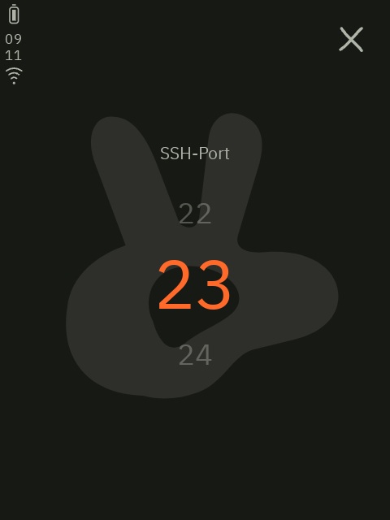

# Design

One conversation, one moving mark. Most interaction happens through the wheel and side button.

- Dark mode only: graphite `#171915`, warm text `#F2F0E8`, secondary text `#AFB4A8` and orange selection `#FF6A2A`.
- The logo stays behind the interface. It is bright at rest and while listening, quieter behind text, and changes shape with activity. No side glances or motion setting.
- Chat text scrolls freely. Messages are not selectable cards; there are no conversation titles, folders or new-chat controls.
- Battery, clock and Wi-Fi move from a horizontal rest-screen row into a narrow vertical rail at the top left.
- Menus are vertical. Selection is orange. Transitions are short crossfades, not separate screens full of instructions.
- Both cameras fill the display with a small touch-only X at the top right. The photo camera uses the side button as a shutter; the setup scanner recognizes QR codes automatically.
- Setup has no text input. A QR supplies connection details; the SSH port also has a vertical number wheel.

IBM Plex Sans provides the type. The logo uses compatible paths for continuous morphing. Quiet motion is capped at roughly 12 updates per second, active states at roughly 30; hidden animation pauses and disabled system animations are respected.

These are emulator-verified choices. Readability, input mapping, motion and energy use still need testing on the r1.
